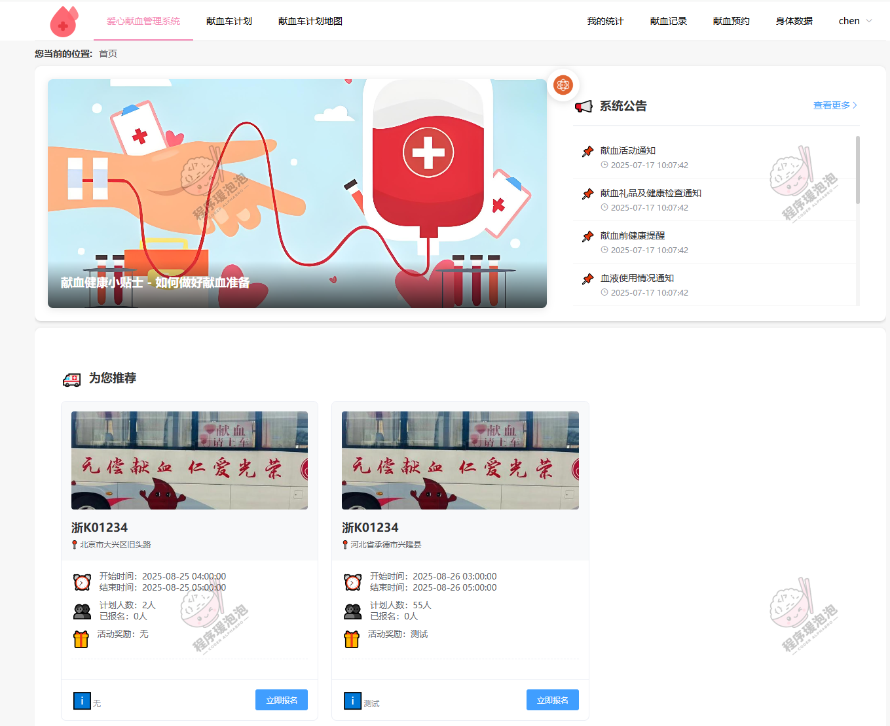
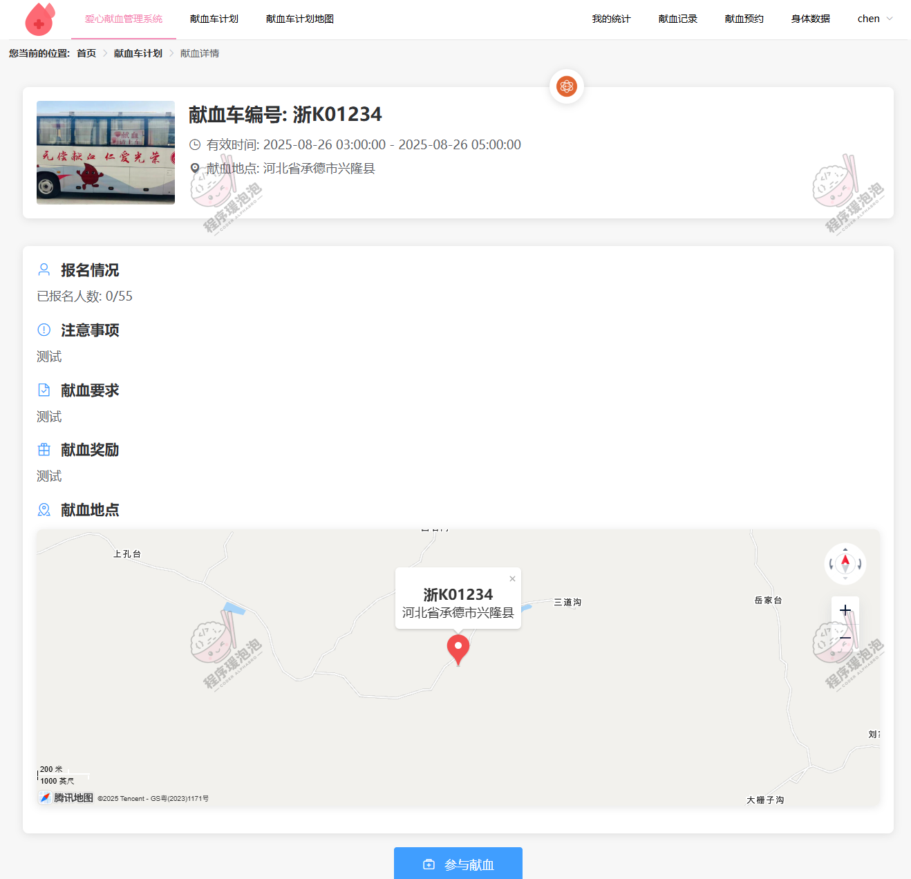
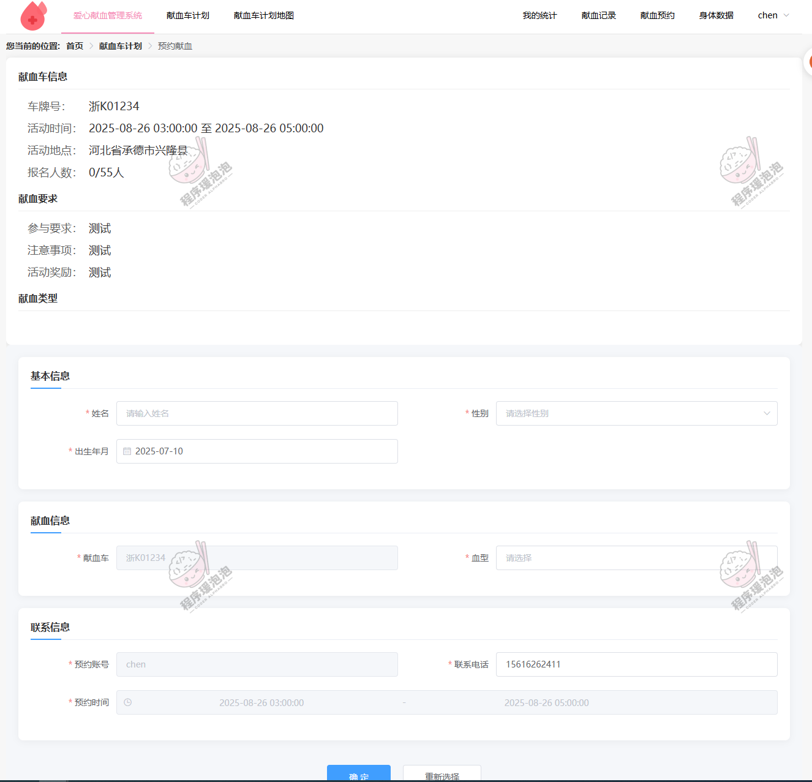
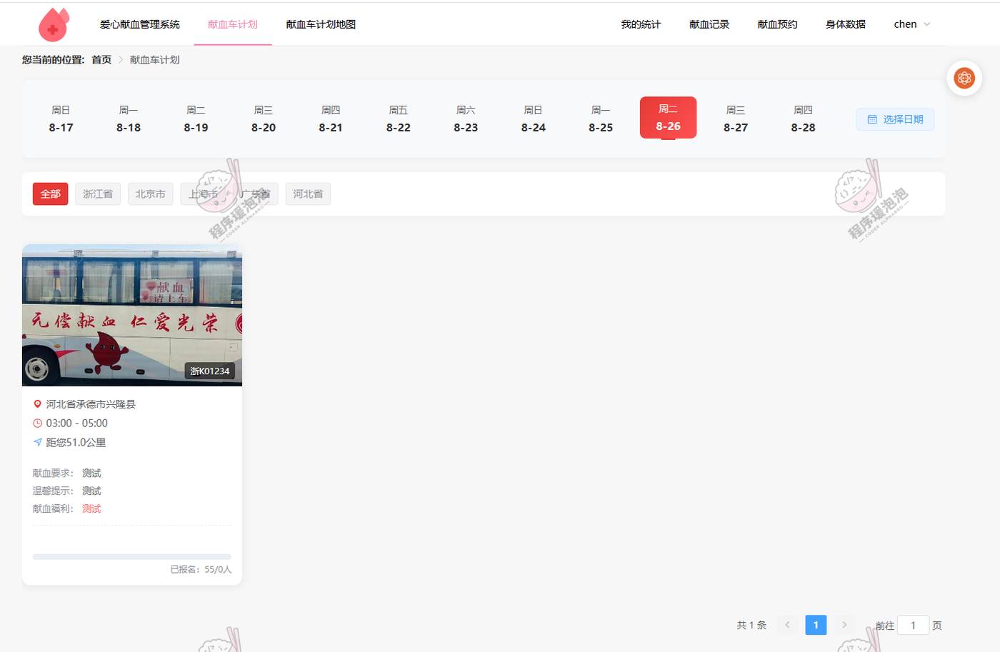
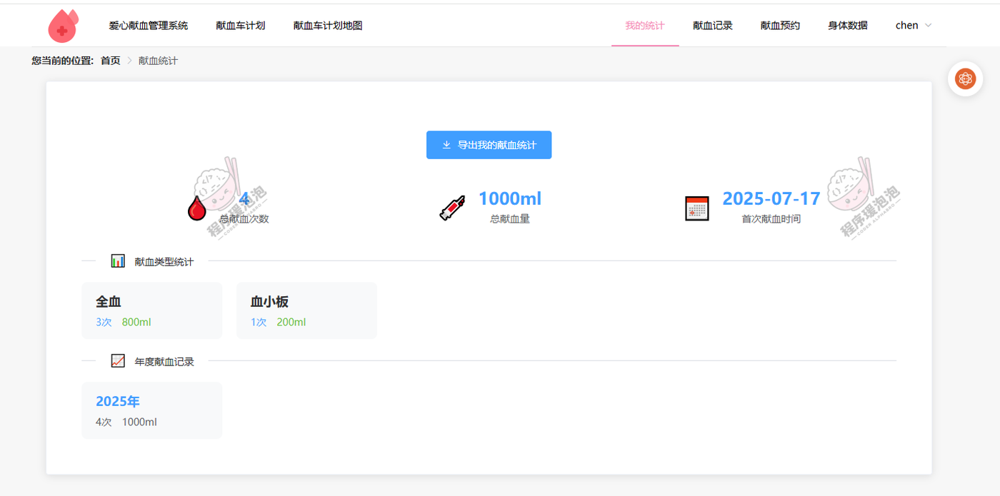
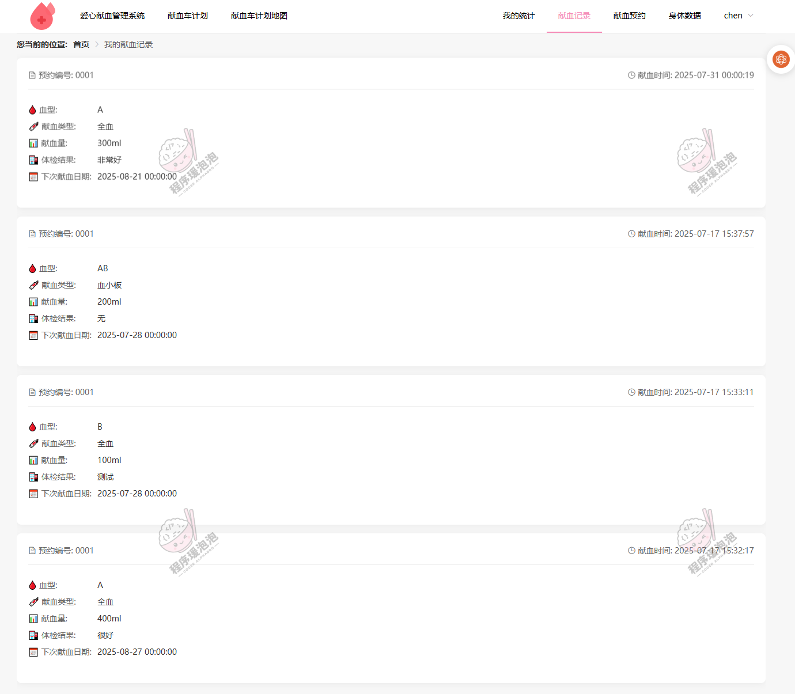
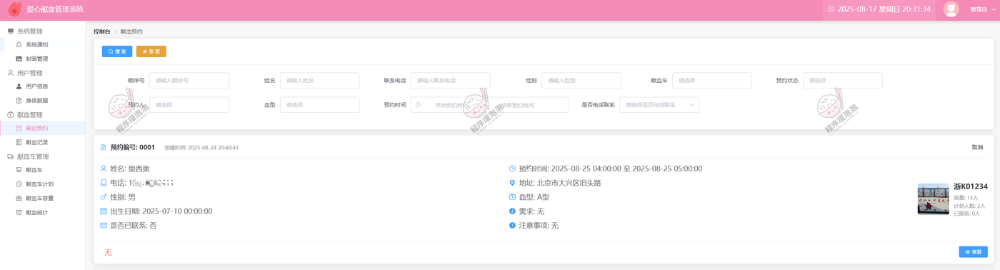
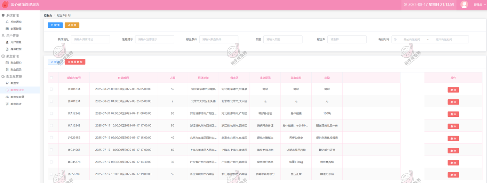
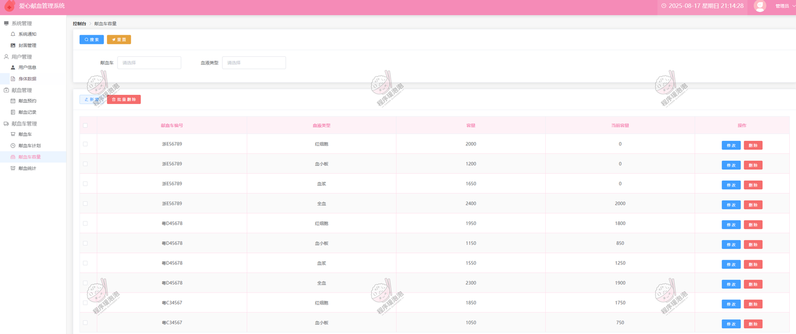
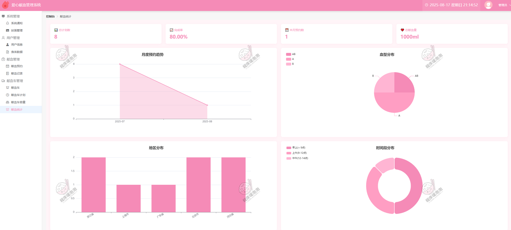

# LoveBloodDonation
爱心献血管理系统 
创新点：AI问答、协同过滤算法、腾讯地图API、Echarts图形化分析、预约与献血记录联动、Haversine球面距离计算、 预约校验与计划冲突检查、献血车容量管理、ECharts数据分析；
角色：用户、管理员；

所有源码均本人开发，项目是前后端分离的，所有的项目都具备了完整的业务逻辑，不仅仅局限于基础的增删改查（CRUD）操作，系统亮点众多。

本文注重于计算机毕业设计选题指导，列出题目均有源码， 大家可以去【公众号】(毕业终点站)获取或者加我【qq】(2112698948)提意见(别忘记Star哟)。备注：git

声明：仅用于学习使用，请勿用于任何商业行为！

1.系统非商用，非开源，非无偿。

2.由本人开发，如需源码，请联系以下方式，qq:2112698948。 https://home.biyecode.com/

3.项目有很多，并未全部上传，如果未找到想要的，可直接咨询。

# 爱心献血管理系统

基于用户前台 + 管理后台的献血服务平台，把献血计划推荐、地图查看、在线预约、献血登记和个人统计串成一套流程。用户端面向献血者，管理员端负责献血车、计划、预约审核和献血统计分析。

## 项目简介

- **架构**：B/S、MVC、前后端分离，用户前台 + 管理后台
- **开发环境**：IDEA、JDK17、Maven、MySQL、Node.js
- **后端技术**：Java、Spring Boot 3.3.1、Spring MVC、MyBatis-Plus、MySQL、JWT
- **前端技术**：Vue 2.6、Vue CLI、Element UI、Vue Router、Vuex、Axios、ECharts、腾讯地图 JavaScript API

## 系统亮点

- **献血计划推荐算法**：结合用户与活动地点的距离、历史献血时间间隔、活动奖励和当前预约人数计算推荐分数，按分数排序展示前 5 个计划，帮助用户挑选活动。
- **Haversine 球面距离计算**：根据用户与献血计划的经纬度计算距离，为计划推荐提供距离评分依据。
- **腾讯地图展示**：将献血计划位置以标记形式展示在地图上，点击标记查看活动信息，便于了解献血地点。
- **预约与献血记录联动**：从身体数据填写、预约提交、后台审核到献血登记形成流程；新增献血记录时关联预约完成状态，并更新献血车当前容量。
- **预约校验与计划冲突检查**：提交预约时检查身体数据是否填写、是否重复预约及是否满员；维护献血车计划时检查同车活动时间冲突。
- **献血车容量管理**：按献血类型管理容量，登记献血记录时检查可用容量并累计已采集量，掌握车辆采集情况。
- **ECharts 数据分析**：管理端提供预约、血型、献血类型、区域及车辆容量等多维统计，用户端提供个人献血图表，查看整体业务与个人参与情况。

## 系统功能

### 普通用户端

- 注册登录、首页浏览、公告列表与详情查看
- 献血计划浏览：查看计划列表、活动详情及首页推荐计划
- 地图查看：在地图上查看献血活动位置，选择活动查看相关信息
- 在线献血预约：填写身体数据后提交预约，查看预约状态、取消预约
- 我的身体数据：维护个人身体数据
- 我的献血记录：查看个人献血明细
- 个人献血统计：通过图表查看个人献血数据
- 个人中心：维护个人资料、修改密码

### 管理员端

- 用户管理：维护用户资料，查询和管理用户信息
- 献血车管理：维护献血车信息及不同献血类型的最大容量、当前容量
- 献血车计划管理：维护活动地点、活动时间、预约人数上限及奖励信息
- 献血预约管理：查询预约详情、审核预约信息，跟踪预约状态
- 献血记录管理：关联预约登记献血记录，记录献血类型、血型、献血量及献血时间
- 身体数据管理：查询与维护用户身体数据
- 内容管理：维护轮播图和系统公告
- 献血统计分析：查看预约状态、月度预约趋势、血型分布、献血类型、地区分布及献血车容量等统计
- 个人中心：维护个人资料、修改密码

## 系统截图

> 源文档未提供独立的系统总览图，以下按用户端、管理员端依次展示。

### 一、普通用户端

**首页与推荐计划**

首页含活动轮播图、系统公告和"为你推荐"献血计划卡片，展示献血车编号、地点、起止时间、计划人数、已报名和活动奖励，可直接报名。

**献血详情与地图位置**

详情页展示献血车编号、有效时间、献血地点、报名情况、注意事项、献血要求和奖励，下方以腾讯地图标记活动位置，可点击参与献血。

**预约献血表单**

填写预约时先展示献血车信息、献血要求，再依次填写基本信息（姓名、性别、出生年月）、献血信息（献血车、血型）和联系信息，提交完成预约。

**献血车计划列表**

按日期和地区筛选献血计划，卡片展示献血地点、距离、活动时间、献血要求、温馨提示、奖励和报名人数，其中距离由用户与活动的经纬度计算得出。

**我的献血统计**

汇总献血次数、总献血量、首次献血时间，按献血类型（全血、血小板）和年度展示献血记录。

**献血记录**

以卡片列表展示每条献血记录的预约编号、献血时间、血型、献血类型、献血量、体检结果和下次献血日期。

### 二、管理员端

**献血预约审核**

按预约号、姓名、电话、血型、预约时间、是否周末等条件筛选，展示预约人信息、预约时段、地址、血型、需求与审核状态，支持审核操作。

**献血车计划管理**

维护献血车编号、活动时间、人数上限、具体地址和省市区，配置注意事项、温馨提示与活动奖励，支持修改计划。

**献血车容量管理**

按献血车和献血类型管理容量，登记献血记录时累计已采集量，方便掌握各车辆的采集情况。

**献血统计分析**

含总预约次数、完成率、预约献血人数、总献血量指标卡，并以折线图、饼图、柱状图和环形图展示月度预约趋势、血型分布、地区分布与时间段分布。

---

文档展示 10 张截图，需要了解更多，请联系我。
